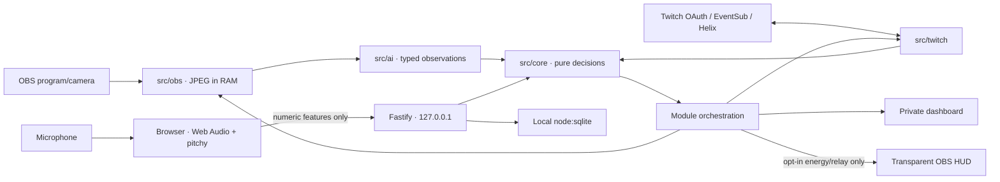

# Spotter

**Most Twitch tools watch the chat. Spotter watches the streamer.**

A safety net, not a guarantee.

A local companion with three modules: Off the Map (identifying-clue exposure), Second Wind (personal voice energy) and Tag Out (click-approved crew raids). Observations from the model, decisions from tested code.

## Current status

The private repository contains the scaffold, pure core, key-free scripted demo and implementations for Twitch, OBS/vision, local audio and crew relays. **Live-service verification and the submission are still pending.** Real OpenRouter vision has been exercised with a private local-video calibration. Real OAuth and EventSub chat rate have been checked on the authorized channel. Live blocked-term enforcement/removal and a controlled Chat Guard deletion have also been verified. Real OBS capture/vision, threshold privacy, stream markers and scene restoration have now been exercised while streaming a prerecorded clip. A real outbound raid and cancellation have now been verified between two owned live channels; tag back is blocked by the receiving channel’s minimum raider-account age. Natural microphone capture remains unverified.

| Area | Verified | Still needed |
| --- | --- | --- |
| Scaffold/core/demo | Automated tests and browser walkthrough | Real demo media |
| Twitch | Real OAuth/chat rate, blocked-term hold/removal, audited test deletion and CLI/live fixtures | Real raid and submission recording |
| Off the Map | Real OBS/vision → privacy/marker → restore; WebSocket disconnect survival; private dashboard take | Full-motion submission edit; full OBS-process shutdown proof |
| Second Wind | Shared mic/file extractor, 11-minute TTS baseline, measured energy/chat and real OBS HUD | Natural microphone and tired-voice validation |
| Tag Out | Approval/live guards, cancellation and real two-channel raid/tag-back with EventSub home confirmation | Finished video edit |

## Run locally

Requires Node.js **22.18+**, npm, TypeScript strict/ESM. Checks here ran on Node **25.4.0**; the minimum Node version has not been exercised.

```sh
npm ci
cp .env.example .env
npm run dev
```

| Surface | Default URL |
| --- | --- |
| Private dashboard | http://127.0.0.1:5173/dashboard/ |
| Local microphone sensor | http://127.0.0.1:5173/sensor/ |
| Transparent OBS browser source | http://127.0.0.1:5173/overlay/ |
| Session report | http://127.0.0.1:5173/dashboard/report.html |
| Local API | http://127.0.0.1:3210/api/health |

Both servers bind to `127.0.0.1`. Keep this tool local. Vite updates frontend files automatically; restart the command after server edits. The API rejects foreign Host headers and write/WebSocket origins. It is not a hosted multi-user service.

## Key-free demo

```sh
npm run demo
```

No `.env` or credentials are needed. `SIM=1` disables all live integrations and microphone activation. The accelerated story shows generic clues accumulating, a reversible privacy blur, declining energy and chat activity, an audited simulated mod-review flag, a partner suggestion and a relay. Click **Approve simulated raid**, then **Request tag back** and the partner's separate approval. **Replay simulated session** restarts the story. Every simulated view/source displays `SIMULATED`.

The default image is our synthetic SVG fixture. Mock clues follow the deterministic script; no model interprets those pixels. The initial chat window is warmed up so the report correctly compares 20 → 12 messages/min (−40%). Set `SIM_FRAME_DIR` to owned JPEG/PNG/SVG fixtures to replace the illustration: 1–20 images, at most 2 MB each and 20 MB total. Existing fixtures are read into memory; captured/model frames are never written to disk. Real IRL and voice media are pending.

## Broadcast design

The private dashboard has a smoothly animated exposure dial, keyed clue chips that enter only when new evidence arrives, a visible privacy wipe/shield and a game-style segmented stamina reserve. Rally stays separate from measured energy. The relay baton waits for approval, travels while a raid is pending, lands only after confirmation and reverses for tag back. Privacy visuals use the actual applied state in live mode; an unavailable action cannot display an applied shield.

The OBS HUD has its own entry point and reads only `/api/overlay`. It shows opted-in stamina/rally and relay state, never exposure, clue chips or a privacy indicator. Its background is transparent at 1920×1080 and 1280×720. Both views preserve SIMULATED labels and respect reduced-motion preferences. Click Replay to record the sequence again.

## Calibrate real vision with a local video — no OBS

Use the existing `ffmpeg` and `ffprobe` commands (both are required on PATH). Configure `OPENAI_API_KEY`, `OPENAI_MODEL` and `OPENAI_VISION_DETAIL` in `.env`, then run:

```sh
npm run calibrate -- --video "/absolute/path/to/owned-irl-clip.mp4" --interval 4 --max-frames 120 --output data/irl-calibration
```

Alternatively set `VISION_VIDEO_PATH` in `.env` and omit `--video`. The command samples every four seconds by default at `VISION_FRAME_WIDTH=1280`, matching the configurable OBS capture width. `--interval` accepts at least one second; `--max-frames` defaults to 120 and caps API calls. It analyzes **sampled frames**, not every original video frame. Each sample makes a billable real vision request unless explicitly using the mock mode below. No new npm dependency was added.

The original clip stays local. JPEGs go from ffmpeg stdout to memory and then to the same `ResponsesAI.vision` contract used by OBS, with `store: false`. No extracted image is written to disk; audio is neither sent nor recorded. The mode instantiates no OBS/Twitch client and executes no automatic action. Captured output is labelled **SIMULATED · REAL VISION** because the input is prerecorded, even though the model analysis is real.

Reports are private files under ignored `data/` by default:

- `irl-calibration.json`: configured model/detail/frame width/AI timeout/thresholds, media duration, sampling interval/cap, and every sampled frame's score, availability, generic categories, severity/confidence and hypothetical core requests.
- `irl-calibration.csv`: compact per-sample score log, with media timestamps in milliseconds.
- `irl-calibration.html`: standalone chart/table with warning/action lines for threshold inspection.

The reports contain no images, raw model text or source filename/path. HTTP failures, timeouts, refusals, incomplete responses and invalid observations have sanitized diagnostic categories (plus HTTP status for HTTP failures), never raw provider messages. Missing/refused/timed-out vision retains the last score and records `analysis unavailable` with no hypothetical action. Hypothetical requests represent core state transitions, not actions repeatedly executed at every high-score frame. Inspect the sample rows and adjust `EXPOSURE_WARN`/`EXPOSURE_ACT` in `.env`, then repeat; the tool does not declare or infer a location. Check the CLI's limit notice / JSON `capped` flag when a long clip exceeds the sample cap. Keep reports private.

For a key-free smoke check only, use explicit mock vision:

```sh
SIM=1 npm run calibrate -- --mock --video "/absolute/path/to/clip.mp4" --max-frames 3 --output data/mock-calibration
```

That output is labelled SIMULATED · MOCK VISION. The integration test generates an owned silent synthetic video, extracts JPEGs in memory and verifies that only video input plus JSON/CSV/HTML reports exist afterward. A real local-video calibration has also completed through OpenRouter; its reports and analysis remain private under ignored `data/`. This verifies recorded-image analysis, while live OBS actions still need a separate recording.

### Recorded-video width comparison (2026-10-29)

With explicit approval, the same three source timestamps (0, 2, 4 seconds) were analyzed at 768px and compared with the existing 1280px probe. Both runs used `openai/gpt-4.1-mini`, `high` detail, a 15000ms timeout, identical thresholds and a fresh score history; both returned 3/3 available samples. Scores include prior samples, rather than independent frame ratings.

| Time | 1280px probe: score / categories | 768px probe: score / categories |
| --- | --- | --- |
| 0s | 62 / storefront, other | 41 / storefront, street_sign, other |
| 2s | 59 / storefront | 40 / storefront |
| 4s | 83 / storefront, house_number | 62 / street_sign, storefront, house_number |

**Keep 1280px as the default and provisional warning/action thresholds of 60/80.** At 768px, the warning moved from 0s to 4s and no sample reached 80; the building-number observation at 4s had lower severity/confidence (1/0.7 versus 3/0.8). The extra `street_sign` category is a model label, not independently verified evidence. This small comparison supports retaining image detail, but does not establish that width alone caused the difference: the existing 1280px full run already varied from the probe (scores 62/60/73 at the same times). It does not justify lowering thresholds to compensate. No 768px full run or live OBS action was performed. Detailed reports remain in ignored `data/`; extracted images were never saved.

## Twitch

Register an app with the exact redirect URI `http://localhost:3210/api/twitch/callback`. Set `TWITCH_CLIENT_ID`, `TWITCH_CLIENT_SECRET` and `TWITCH_REDIRECT_URI` in `.env`, start `npm run dev` and click **Connect with Twitch**. OAuth uses expiring, single-use state. Tokens remain in the ignored local SQLite database, are validated at startup/hourly and refreshed server-side. Server-created data uses owner-only permissions; protect `.env` too.

Native WebSocket EventSub handles chat, both raid directions and online/offline events. It subscribes immediately after welcome, dedupes IDs, watches keepalives and reconnects with backoff. The dashboard retains activity IDs and aggregates rather than raw chat text. Helix uses plain `fetch` without a Twitch SDK. Writes are not blindly retried after ambiguous failures.

Offline fixtures are synthetic shapes based on official docs, **not CLI captures**. Twitch CLI is not installed here. Complete its fixture/live steps in [the human verification checklist](docs/LIVE_CHECKLIST.md).

## AI endpoint: direct OpenAI or OpenRouter

Current configured model: **`openai/gpt-4.1-mini`, served via OpenRouter using the same Responses API contract**. `AI_BASE_URL=https://openrouter.ai/api/v1` selects OpenRouter; `AI_BASE_URL=https://api.openai.com/v1` selects OpenAI direct with native model ID `gpt-4.1-mini`. Model IDs remain configuration, not hard-coded runtime choices.

`AI_BASE_URL` defaults to `https://api.openai.com/v1`. The client appends `/responses`, accepting a trailing slash. This configuration applies to both the live server and `npm run calibrate`, and to vision and chat classification. Existing OpenAI setups work without setting this variable.

For OpenRouter, configure `.env` as follows:

```dotenv
AI_BASE_URL=https://openrouter.ai/api/v1
OPENAI_API_KEY=your-openrouter-key
OPENAI_MODEL=proveedor/modelo
OPENAI_VISION_DETAIL=high
```

`proveedor/modelo` is a placeholder for the exact OpenRouter model ID: a provider/author prefix, slash, then model name (for example the shape `openai/<model-id>`). Choose a listed model supporting **image input and strict JSON Schema**. Keep using the existing `OPENAI_API_KEY`/`OPENAI_MODEL` variable names; set the key for the selected service. For direct OpenAI, use an OpenAI key and the native model ID without OpenRouter's provider prefix.

Only the exact `openrouter.ai` host receives `provider: { require_parameters: true }`. Requests retain image input, `text.format` with strict `json_schema`, and `store: false`; Spotter never retries by dropping the schema or routing preference. OpenRouter's parameter filter requests compatible routing; model/provider support and schema enforcement can still vary. A rejected schema/unsupported provider is handled as `analysis unavailable`: retain the last exposure score and execute no new automatic action. Runtime observation validation stays enabled. This behavior is covered with mocked requests; real OpenRouter calls have also been exercised in the calibration and evaluations documented below.

See [OpenRouter Responses](https://openrouter.ai/docs/api/reference/responses/overview), [provider routing](https://openrouter.ai/docs/guides/routing/provider-selection) and [structured outputs](https://openrouter.ai/docs/guides/features/structured-outputs).

The chat works while the channel is offline. Open `https://www.twitch.tv/popout/YOUR_CHANNEL/chat?popout=` and sign in to chat; authorizing Spotter does not sign the embedded browser into Twitch. For blocked-term and deletion proof, use a second account without broadcaster/moderator privileges. Twitch cannot delete the broadcaster's or another moderator's messages. Use artificial test phrases with no actual identifying information, keep the returned blocked-term ID, and remove the temporary term afterward.

`npm run twitch:fixtures` regenerates raid/online/offline payloads with the installed Twitch CLI, using fake IDs and no configuration. Those are **CLI-generated mock events**, not live-service evidence. CLI 1.1.24 does not support `channel.chat.message`; the chat fixture instead comes from a controlled live EventSub observation with identities/text substituted. Tests now consume these files; provenance and reproduction commands are in [the fixture README](test/fixtures/twitch/README.md). `npm run twitch:proof` checks public identity/scopes without printing credentials; `-- --capture-chat --send-test` additionally sends one controlled message to the authorized broadcaster's own chat and captures only that matching event, redacted.

## Set up OBS scenes for a recorded clip

Enable OBS's WebSocket server and set `OBS_WEBSOCKET_PASSWORD` in your ignored `.env`. Set `VISION_VIDEO_PATH` to a local video, then run:

```sh
npm run obs:setup
npm run dev
```

The setup authenticates via obs-websocket v5 and verifies its work by reading scenes, scene items and input settings back from OBS. It creates or reuses **Main** and **Privacy** in the current scene collection:

| Scene | Sources, bottom to top |
| --- | --- |
| Main | **Spotter IRL** — local media, looping; **Spotter Overlay** — `/overlay/?recorded=1` |
| Privacy | **Spotter Privacy** — opaque branded `/privacy/`; the same **Spotter Overlay** |

Both browser inputs render at **1920×1080** and fit the current OBS canvas. The media fits without cropping; the privacy browser covers the whole canvas. The recorded-input overlay keeps **SIMULATED** visible even when public stamina/relay is disabled; scores and clues remain private. The page uses local assets and no private API data.

The command updates only `OBS_MAIN_SCENE`, `OBS_PRIVACY_SCENE`, `OBS_SOURCE`, `OBS_OVERLAY_SOURCE`, `OBS_PRIVACY_SOURCE` and `OBS_BLUR_FILTER` in `.env`, preserving credentials. `OBS_SOURCE=Spotter IRL` captures the video directly; `OBS_PRIVACY_SCENE=Privacy` and an empty `OBS_BLUR_FILTER` select scene-switch privacy. Dismissal restores the previously active scene. Main/overlay/privacy source names are fixed by this setup; the extra source-name variables document its targets. Restart an existing `npm run dev` after environment changes. The setup needs OBS open; the browser sources need Vite running on `127.0.0.1` (`VITE_PORT`, default 5173).

Reruns reuse sources/items, repair settings/visibility/transforms/order, and update changed URLs or clip paths without duplicating inputs. Unrelated sources remain; the privacy backdrop covers any existing sources beneath it. Conflicting input types stop with an error. No blur plugin is required. The command does not start streaming/recording, switch the current program scene or send video to AI. Connection/request failures print sanitized diagnostics, never raw credentials; code 4009 means authentication was rejected. Automatic OBS privacy/restore and marker integration were subsequently verified while streaming the clip; private evidence stays under ignored data/takes/.

## Off the Map

Set `OPENAI_API_KEY` and `OPENAI_MODEL` to a model supporting image input and strict Structured Outputs. Set `OPENAI_VISION_DETAIL=high` (default); `low` and `auto` are also accepted. `VISION_FRAME_WIDTH=1280` controls both video extraction and OBS screenshots (integer 128–4096); `AI_TIMEOUT_MS=15000` controls the AI request timeout (integer 1–120000 milliseconds). Invalid values are rejected before a request. No model name is hard-coded. Set `OBS_WEBSOCKET_PASSWORD`, `OBS_WEBSOCKET_URL` and `OBS_PRIVACY_SCENE`. Optionally set both `OBS_SOURCE` and `OBS_BLUR_FILTER` to use a filter. With these configured, the live server samples JPEGs at `VISION_FRAME_WIDTH` (1280px by default) at `VISION_CAPTURE_INTERVAL_MS` (4000 ms by default; 2000 ms is supported).

The schema contains clue categories, generic allowlisted descriptions, severity and confidence. Runtime parsing rejects extra fields, literal text, invalid values, refusals and incomplete responses. Core scoring combines distinct categories over time with decay. Configure `EXPOSURE_WARN`/`EXPOSURE_ACT` (defaults 60/80). A warning stays private; an action applies privacy and requests a marker. Missing analysis retains the score and cannot trigger an action. Dismiss restores the previous scene/filter state; restoration failure remains retryable.

The live OBS check exposed a JPEG MIME alias (`image/jpg`); the adapter now normalizes it to `image/jpeg` before vision validation without changing image bytes or saving frames. Dismissal invalidates pending vision, waits for an already-sent privacy scene RPC before reversing it, and prevents the canceled sample from sending its next marker. Marker receipt/status and sanitized HTTP status appear only in private `/api/status`.

Stream markers require [VOD storage to be enabled](https://dev.twitch.tv/docs/api/reference/#create-stream-marker). In the real test, HTTP 404 cleared after the user enabled past-broadcast storage and restarted their stream. `npm run twitch:markers` reads back only Spotter marker IDs/times/positions, omitting other marker descriptions and playback URLs. `npm run obs:proof` reads only scene/media/output-active metadata; it never requests stream service settings or a stream key. Its explicit `--main`, `--cue-demo`, `--cue-building`, `--resume` and source-only `--restart` flags change the demo scene/media; `--watch-scenes` records scene-name changes for 90 seconds. `--capture-metadata` inspects a JPEG in memory and returns only MIME/length.

For a controlled connection test, local POST `/api/obs/disconnect` invalidates in-flight analysis and stops only Spotter's WebSocket/retry loop; POST `/api/obs/reconnect` restores it. These routes do not stop streaming or recording. During the real 14-second disconnected window, eight health checks returned 200, the last score stayed unchanged, analysis was unavailable, the decision timeline did not grow and no new stream marker appeared. This checks a client-link interruption, not shutting down the OBS application.

The Responses request sets `store: false`. Images exist only in memory; the overlay receives no exposure/clue data. Provider-side handling follows the selected service/account's data controls: this setting is not a claim of zero provider retention.

Chat Guard runs when Twitch and AI are configured. Pure core logic flags high-confidence guessing messages for private mod review by default; `CHAT_AUTO_DELETE=1` explicitly opts into deletion. The confidence threshold remains 0.8. The private dashboard provides a visible mod notice and audit of message IDs, timestamps and outcomes; it never retains message text. Sensitive terms entered in the dashboard go to Twitch blocked terms without local storage. Keep their returned IDs for removal.

## Second Wind

Open the sensor and click **Enable local microphone**. Web Audio requests echo cancellation, noise suppression and automatic gain control off. `pitchy` clarity-gates F0. RMS, pitch median/range, spectral slope, voiced ratio, pause length and a rough envelope-peak speech-rate proxy are calculated in-browser. Only a closed object of numeric features leaves at approximately one-second intervals. Binary packets, extra fields, stale values and excessive rates are rejected.

The sensor also accepts a **local audio file**, marked **SIMULATED**, in normal `npm run dev` mode. Choose it on `/sensor/` and click **Play file**; no virtual microphone is needed. Web Audio decodes the file in browser memory, connects it to the same analyser and `NumericAudioPipeline` / `FeatureWindow` used by the microphone, and sends the identical closed numeric packet once per second. Neither file bytes nor PCM are uploaded. Optional **Hear file locally** monitors playback after the analyser without changing its measurements; monitoring is off by default. Stop/EOF/disconnection closes the audio context and socket.

The WebSocket handshake declares `source=file` or `source=microphone`; unknown sources are rejected. File input has its own stored numeric baseline (`audio_baseline_file`) and source-labelled session. Switching sources does not mix baselines or curves; recalibration resets only the selected baseline. The dashboard, report and public HUD show SIMULATED for file audio while Twitch/OBS continue their real integrations. This source flag does not switch the whole app into the scripted `SIM=1` mode.

For TTS, calibrate with at least ten minutes of reference audio (allow more than 601 seconds so the first/last feature windows span ten full minutes). For a shorter reference, loop a copy; the current private test uses an 11-minute `calibracion-loop.wav` derived from the 7:25 original. Keep the sensor visible during playback. Sparse/throttled samples cannot silently complete calibration. A grace period in the numeric calibration buffer accommodates ordinary packet jitter without shortening the pure ten-minute baseline requirement.

Then select the demo file and replay it against that same baseline. Energy averages the last **45 seconds**; a short ending may still be mixed with earlier energetic speech. If needed, repeat only the last 30 seconds in a derived file, preserving the original beginning, and compare measured scores. TTS/progressively modified audio demonstrates the energy signal; it does not validate fatigue detection. Correlation with controlled real Twitch test messages is association, not evidence of organic audience retention or causation. All source audio, derived WAVs and private numeric comparison reports remain in ignored `data/`.

The private TTS comparison on 2026-10-29 used the same saved baseline and real-time browser extractor:

| Input | Duration | First 20s median | Last 15s median | Minimum |
|---|---:|---:|---:|---:|
| Original demo | 81.48s | 74 | 56 | 55 |
| Original + last 30s repeated twice | 141.48s | 74 | 56 | 55 |

The extended file preserves the entire original PCM prefix byte for byte. Repeating the ending confirmed a plateau rather than a stronger decline. Three authorized test messages travelled through real Twitch Helix/EventSub; the original run's paired correlation was approximately −0.864 because chat increased while energy fell. This controlled association is not an audience-retention result. No additional chat messages were sent in the replay.

`ENERGY_ALERT_THRESHOLD=45` configures the **combined alert only**, leaving the energy formula, 45-second averaging, HUD colours and raid suggestion policy unchanged. Energy must remain **strictly below** the threshold for at least **30 seconds**; recovery to the threshold, missing sensor data, source reconnection or recalibration restarts the hold. The alert also requires available vision and exposure ≥60. Configure an integer from 1 to 100 in `.env`; restart the server to apply it. The default is a personal **heuristic, not clinical**.

The choice of 45 is provisional: calibration places the reference near 75 and yields a **theoretical lower score of about 42**, making the former ≤30 alert unreachable with this baseline. **42 was a mathematical bound, not a measured tired-voice score.** Both actual audio endings measured about 55–56, so they do not establish that 45 is a useful operating threshold. A later explicitly processed SIMULATED input demonstrated the decision rule with real OBS vision; it does not validate a natural tired-voice threshold.


A later three-part comparison concatenated `demo-fatiga.wav`, `demo-5.wav` and `demo-6.wav`, with exactly0.5s of silence between them (169.48s total). All original PCM samples were preserved. That untouched combination still reached only55. A separate tail processed with atempo0.85, six extra1s pauses and progressively reduced gain reached46; adding progressive high-frequency attenuation reached45, which still fails the strict<45 test. A final separate float32 WAV completed the tail lowpass progression4000→500Hz over20s and gain−3→−24dB over30s, keeping the original81.48s beginning identical after decoding. It measured44 for44.2 continuous seconds through the unchanged browser extractor. Replaying its last80s alongside the real OBS clip produced combinedAlert=true with real vision available (one receipt:energy44/exposure66). **This is deliberately transformed SIMULATED audio, not a model change or evidence of clinical/natural fatigue detection.** The requested unprocessed concatenation remains a separate file; audio, variants and receipts stay ignored in data/.

If the OBS browser source is blank, verify `http://127.0.0.1:5173/overlay/?recorded=1`, 1920×1080, URL mode, transparent standard CSS, source visibility and dashboard **Public stamina HUD** opt-in. On this machine the source remained transparent even after a fresh URL and a new diagnostic browser source; OBS made no HTTP requests. Restarting OBS **after confirming streaming and recording were both stopped** restored its browser engine and the real HUD. Do not restart OBS during an active output. The opt-in resets when Spotter restarts.

Stop, page close or server disconnection releases microphone tracks. Keep the sensor page active: browsers may throttle background tabs; too few analysis frames produce no measurement. Sensor data older than five seconds is unavailable. Nothing records or uploads raw audio.

Calibration needs a ten-minute span and at least 300 usable windows. A numeric-only baseline profile is saved locally and can be recalibrated. Energy uses smoothed z-scores against that profile. Rally is separate: chat fills its meter and triggers a celebration/nudge without changing the measurement. **Public stamina/rally requires explicit HUD opt-in**; the opt-in resets on server restart.

The report shows this server session's curves, peak/low, percentage changes and correlation. Live numeric aggregates are saved every 30 seconds. It currently covers the running session; correlation establishes no cause, and energy is a heuristic, not a health/fatigue assessment.

## Tag Out

Run one local Spotter instance per broadcaster with separate API/Vite ports and SQLite files. Each authorizes its own Twitch account. Twitch tokens stay in that instance's database.

Copy [the crew example](docs/crew.example.json) to ignored `data/crew.json`, fill the partner's numeric Twitch user ID, local endpoint and shared secret, then set `CREW_FILE=data/crew.json`. Each instance's `CREW_SHARED_SECRET` goes into the other instance's peer config. The authenticated loopback status endpoint shares **only energy/live status**, never OAuth tokens or clues. Configure the second instance's ports, database and registered OAuth redirect as well.

`TAGOUT_ENERGY_THRESHOLD=45` and `TAGOUT_SUSTAIN_S=60` configure the automatic suggestion: available energy must stay **strictly below45 for60s** by default. The partner must still be live with energy≥60. These are personal heuristics, not clinical thresholds: the prior file baseline had a theoretical floor around42 (the original tired endings actually measured55–56), making the old30 rule unreachable for that profile. The processed SIMULATED demo now measures44. No energy score or calibration formula changed.

**Request tag out** requests a suggestion manually without waiting for personal low energy; it never starts a raid. Both live-channel/partner requirements still apply, and the separate approval button remains mandatory. A pending/persisted raid cannot be replaced by a new manual request.

For two local accounts, register both OAuth redirects (3210/3220), then run `npm run crew:dev -- primary` and `npm run crew:dev -- secondary` in separate terminals, instead of an already-running dev process on those ports. The launcher creates private600-mode files under ignored `data/crew/`, uses API3210/Vite5173 for the principal and API3220/Vite5174/secondary.sqlite for the companion, and disables OBS/AI in the companion server. It inherits the Twitch app credentials internally without printing/copying them into crew JSON. Authorize a different account per instance, run `npm run crew:link`, and restart both to load reciprocal peer identities. Duplicate account IDs are rejected. Vite denies all HTTP access to data/, including /@fs paths; the sensor reads selected files locally. `/dashboard/crew.html` provides two visible sensor panes; normal separate sensor tabs are also available.

When replacing a companion after an unfinished relay, stop both Spotter instances while both channels are offline and run `npm run crew:retire` before authorizing the replacement. It archives the old cycle locally, returns to idle without a Twitch action or home confirmation, and preserves raid-attempt history. Live or pending raids are refused. OAuth forces account verification; authorize the replacement on3220, relink and restart both instances.

On this Mac, `npm run obs:secondary -- --launch` opens a second OBS with a separate WebSocket port4456; `npm run obs:secondary` prepares profile/collection **Spotter - alredio**, Main/Privacy and a public browser overlay pointing to5174. The user configures the secondary Twitch stream credentials manually. No output starts automatically, and no stream settings/key are requested by the helper. Profile changes are refused while stream/record output is active. The primary remains on4455. A frozen secondary can be restarted independently; the setup now times out instead of hanging.

The second OBS browser engine failed to render during the live test. `npm run obs:hud-bridge` is a temporary workaround: the working primary engine renders **only the public receiver overlay**, off canvas, and its transparent PNG updates an image source in secondary Main/Privacy. No camera/vision frames or private dashboard data enter the bridge. The helper must run for live updates; stop it with Ctrl+C and use `npm run obs:hud-bridge -- --stop` to disable its temporary sources. It does not stop streaming. Native dual-OBS browser rendering remains unresolved.

Definite Twitch4xx rejections (except409) return to a state requiring fresh approval and expose only an HTTP code/static reason, never raw provider text. Network/5xx/409 uncertainty stays pending with cancellation available. A cancellation404 means no raid is pending; it never fabricates a successful raid/home confirmation.

A click rechecks both streams via Helix, partner energy, source token ownership and the persisted request window. The UI waits for EventSub confirmation; the 90-second countdown is informational. Ambiguous write failure stays pending with a cancel path, without automatic retry or false success. State/attempts survive restarts and are isolated per broadcaster.

The receiving partner can request tag back and must approve it with their own dashboard/token. Their opt-in overlay shows “Covering for …’s community”. The two-channel live test verified the automatic suggestion, manual request, click approval, cancellation, Twitch-native countdown and outbound EventSub confirmation. Tag back was requested/approved from the companion but rejected with HTTP400: the primary requires a raider account at least30days old, while alredio was created on2026-10-29. The session is paused; home confirmation remains unverified. See [the handoff](docs/TAGOUT_HANDOFF.md).

## Architecture and ethics



- Never output a location. Generic clue descriptions cannot contain transcribed text or coordinates.
- Keep scores/clues private; never send exposure to the public HUD.
- Raw audio stays local. Captured/model images are not saved.
- A low score says **“no obvious clues detected”**, never “safe”.
- Raids require a broadcaster click; privacy is dismissible; moderation is audited privately.
- Missing analysis means unavailable, never permission to act. Simulations are visibly labelled.

Scores and thresholds are initial deterministic heuristics, not validated safety guarantees. This local hackathon implementation is not a hosted security product. Real-service compatibility and the complete recorded product flow remain unproven until the checklist is completed.

## Checks and Codex

**152 automated tests (152 passing, 0 failing, 0 skipped)** currently cover core decisions, contracts, service adapters, the scripted story, numeric WebSocket transport, persistence and process-level startup/shutdown. Browser QA covered the demo, report, mic refusal in SIM and transparent overlays at 1280×720 and 1920×1080.

```sh
npm test
npm run typecheck
npm run lint
npm run build
```

Tests use `node:test`/`node:assert` and fixtures under `test/fixtures/`. Startup checks open loopback ports; a sandbox that forbids `listen()` needs network-enabled execution. Lint checks whitespace, eval and core purity; TypeScript also checks unused declarations.

Codex read [BRIEF.md](BRIEF.md), followed [AGENTS.md](AGENTS.md), wrote core tests before changing logic, turned observed failures into regressions, and committed/pushed each implementation phase. See the dated [work log](docs/codex-log.md), [session ID](docs/CODEX_SESSION.md), [plan](PLAN.md) and [remaining human checklist](docs/LIVE_CHECKLIST.md).

References: [Twitch OAuth](https://dev.twitch.tv/docs/authentication/getting-tokens-oauth/), [EventSub](https://dev.twitch.tv/docs/eventsub/handling-websocket-events/), [Helix](https://dev.twitch.tv/docs/api/reference/), [Responses Structured Outputs](https://developers.openai.com/api/docs/guides/structured-outputs?api-mode=responses), [image input](https://developers.openai.com/api/docs/guides/images-vision), [OBS client](https://github.com/obs-websocket-community-projects/obs-websocket-js), [pitchy](https://github.com/ianprime0509/pitchy).

### Recording view and measured session evidence

Open `/dashboard/?record=1` for a1920×1080 recording layout: reduced header and all six cards, including both alerts, fit within1080px. Dashboard text and SVG axis/event labels are at least14px. `Request tag out` still only suggests; the raid requires its separate approval.

Dashboard/report charts default to an available recorded numeric take from ignored `data/takes/`; use **Chart source** to switch to the current session or another recording. The startup catalog includes the measured processed-file energy take, measured combined-alert take and real two-way Twitch relay. Each recording is separately labelled; simulated audio stays marked SIMULATED even when Twitch was real. We do not merge sessions, interpolate missing samples, infer chat traffic or claim privacy merely because exposure crossed80. The relay capture did not record chat and is labelled accordingly. A new recording becomes available after server startup/catalog loading.

Curves use elapsed time, actual sample spacing and event annotations. Correlation is hidden below20 valid energy/chat pairs and when either series lacks variation; otherwise it shows two decimals and n. The report uses measured peak/minimum, first-to-last percentage changes, paired count and timed key moments. Zero starting chat gives an unavailable percentage, not an invented decline.

In real mode the private Frame Monitor shows only the last successfully analyzed OBS frame, with generic clue chips. It is held in memory, never put into the status/report/overlay payload, never written to disk and served with no-store through a private-dashboard header. Failure/disconnection clears the preview; SIM alone uses the illustrative fixture. Public overlay names come from EventSub display names, with a cached Helix lookup after restart; lookup failure never prints a numeric ID.

The revised demo changes **synthetic inputs only**: irregular energy≈75→43–44 and high exposure≈80–86, with the same core scores, calibration, thresholds and approval rules. Optional `SIM_DISPLAY_NAME` sets its clearly simulated public host label. Demo-only `/api/demo/playback` and `/api/demo/step` pause/advance virtual playback for reproducible captures; they do not exist in real mode. All ten final design PNGs are local/ignored in `data/screens/`; earlier screenshots are preserved in `data/screens-before-final-pass/`. These are design captures, not additional live-service proof.

In `?record=1` the source selector is hidden while the named source label remains visible. Select a recording by URL when needed: `&take=measured-energy`, `&take=combined-alert`, `&take=relay-round-trip` or `&take=current`. Dashboard and report hide absent/zero-only chat activity instead of drawing a baseline at0, with the legend `chat not recorded`; genuine zero intervals remain part of an otherwise observed active series. This is presentation only; stored data, statistics and decision rules are unchanged. Event captions use actual SVG text widths, three non-overlapping rows and leader lines to their original timestamps.

## Observations, decisions, and residual latency

**Observations from the model, decisions from tested code.** This wording distinguishes typed model evidence from the tested TypeScript policy that computes scores and approves actions. It does not change that policy.

The exposure score measures the accumulation of identifying clues over time, with the existing decay and category combination rules. It is not a single-frame censorship classifier. Repeating one clue does not necessarily raise the score. A low score means “no obvious clues detected,” never “safe.” A clue can already have appeared publicly before the next sample, model response, or scene switch: there is residual latency.

Set `VISION_CAPTURE_INTERVAL_MS=4000` (default), or `2000` for more frequent sampling. There is no backlog: an in-flight sample skips subsequent timer opportunities. Sampling adds approximately 0–4 seconds of waiting at 4000 ms, or 0–2 seconds at 2000 ms, before capture; slow analysis may add more. This waiting is **outside** the measured capture-to-action latency. OBS rendering/transition, encoding, network and Twitch player latency are also outside the measurement; OBS program-scene readback confirms the scene assignment, not the final pixel seen by a viewer.

`/api/latency` and the private dashboard show median, nearest-rank p95 and n for confirmed scene changes. The last 200 real sample attempts separately track capture, model, decision, analysis, missing analysis and failed confirmations. Samples without an action do not count as completed protection. SIM does not invent real timings. With no live confirmed actions, the dashboard explicitly labels the controlled recorded benchmark instead.

Measured 2026-10-30 on this local machine: **capture → confirmed Privacy median 2.15 s, p95 2.62 s, n=10**, 0 unavailable analyses. Real OBS, real OpenRouter `openai/gpt-4.1-mini`, high detail, 1280 px, 4000 ms cadence. This is a **controlled benchmark with original synthetic input**, ten rearmed sequences: eight triggered on the first sampled frame and two on the second. The timer starts with the triggering capture, not the earlier evidence-accumulation period. It is not an organic IRL timing distribution, a service guarantee or a viewer-latency measure; n=10 makes p95 the largest observed value. Repeated attempts with the natural clip did not cross 80, so no completed-action latency is claimed for those attempts. No thresholds or observations were forced.

Run `npm run bench:latency` with OBS open and stream/record outputs stopped. It temporarily isolates Spotter's OBS connection, uses the existing local IRL clip and unchanged temporal decision path, and restores the prior scene/media state. Ten rearmed sequences are capped at nine actual samples each. Use `npm run bench:latency -- --fixture` to reproduce the controlled synthetic-input benchmark: ffmpeg renders the original tracked frame-21 into a temporary local clip in data/, patches only the media source, then restores its original settings. No streaming or recording is started. Twitch markers are excluded from this controlled benchmark; production marker behavior is unchanged. Numeric timings stay in ignored `data/takes/latency/latest.json`; frames remain in memory.

Cost: 4000 ms allows at most **900 vision requests/hour**; 2000 ms allows **1800/hour**, roughly twice the potential cost. Busy-sample skips reduce actual calls; chat classification is additional. At the verified GPT-4.1 mini list price ($0.40/M input, $1.60/M output), a 1280×720 image is approximately 1491 input tokens (32 px patches ×1.62), or ~$0.00060 image input per call: ~$0.54/hour at 4 s and ~$1.07/hour at 2 s **for image input alone**. Prompt/schema and output tokens are additional. This is an OpenAI reference estimate, not measured billing or a quote for OpenRouter; routing, caching and provider prices can differ. Sources: [model pricing](https://developers.openai.com/api/docs/models/gpt-4.1-mini), [image token accounting](https://developers.openai.com/api/docs/guides/images-vision).

## Small authored evaluation

`npm run eval` calls the configured real provider against 30 original labelled synthetic scenes and 40 original English/Spanish chat lines. No real places or external footage are used. `npm run eval -- --validate` validates the frozen dataset offline. Sources, licence, gold labels and tracked PNGs are in `test/fixtures/eval/`; per-case outputs stay in ignored `data/eval/`. See [EVAL.md](docs/EVAL.md) for the dataset hash, confusion matrices, coverage and methodology.

Measured 2026-10-30 with `openai/gpt-4.1-mini` via OpenRouter, high detail, 1280×720; no unavailable cases:

| Task | Precision | Recall | TP / FP / FN / TN |
|---|---:|---:|---|
| Independent-frame exposure ≥60 | 100.0% | 50.0% | 10 / 0 / 10 / 10 |
| Independent-frame exposure ≥80 | 85.7% | 60.0% | 6 / 1 / 4 / 19 |
| Identifying category micro | 64.3% | 75.0% | 45 / 25 / 15 / 215 |
| Chat guessing (40 lines) | 100.0% | 100.0% | 20 / 0 / 0 / 20 |
| Chat high-confidence eligibility ≥0.8 (flag by default) | 100.0% | 100.0% | 20 / 0 / 0 / 20 |

These are a small, balanced, author-labelled development check, not a natural IRL holdout or a safety guarantee. Frame thresholds are tested with empty history, so they do not validate temporal protection. The warning detector missed half the authored risk examples; the action detector missed four and escalated one warning-only scene. Category errors matter even when binary chat accuracy looks perfect. I propose **no threshold change yet**: add independently labelled licensed natural sequences and investigate category/severity misses before testing a lower warning threshold. This set alone cannot identify a defensible replacement for 60/80. Scoring, thresholds and calibration remain unchanged.

## Chat Guard consent and review

By default `CHAT_AUTO_DELETE=0`: a high-confidence whereabouts guess generates an **ID-only private mod-review record and visible notice in Spotter's private dashboard**; the message remains on Twitch. This is a local review surface for the streamer/moderators with access to that dashboard, not an automatic Twitch whisper or a notice posted in public chat. No message text or inferred location is stored. Classification errors therefore do not automatically silence chat. Set `CHAT_AUTO_DELETE=1` explicitly and restart to opt into the existing audited Helix deletion path. Classifier failure still takes no action. This changes the action policy, not the classifier, confidence threshold, exposure score or exposure thresholds. Manually configured Twitch Blocked Terms remain a separate explicit streamer action.

## Licensed footage credits

Downloaded source videos stay local under ignored `data/`; extracted natural evaluation frames are memory-only. All these sources use the [Pexels licence](https://www.pexels.com/license/), which allows free use and modification with restrictions; they are not CC0 or an endorsement by their authors or subjects. Labels concern visible clues, not the people in the videos.

| Use | Clip | Credit |
|---|---|---|
| Existing IRL demo, excluded from the new holdout | [Pexels 8275531](https://www.pexels.com/video/people-walking-in-a-busy-street-at-hongdae-8275531/) | 거열 박 / Pexels |
| Natural holdout and sequence: exterior facade | [Pexels 3647789](https://www.pexels.com/video/pedestrians-passing-by-a-storefront-3647789/) | George Morina / Pexels |
| Natural holdout and sequence: forest path | [Pexels 5473790](https://www.pexels.com/video/walking-on-a-pathway-5473790/) | Ambient_Nature_ Atmosphere / Pexels |
| Natural holdout and sequence: commercial street | [Pexels 37063950](https://www.pexels.com/video/busy-urban-street-with-pedestrians-and-shops-37063950/) | Sururi Ballıdağ Director / Pexels |

Reproduction metadata and download URLs are in `test/fixtures/eval-temporal/labels.json`. Verify original clip SHA-256 values against `freeze.json` before evaluation; the runner also checks each extracted frame hash before inference. No natural frame is committed. The optional `scripts/preview-eval.py` authoring tool uses installed Pillow to display a RAM-only contact sheet; it is not a runtime dependency. The three source clips total about259 MB.

## Sequence evaluation and natural holdout

Frozen before inference on 2026-10-30:12 sequences of10 frames, and18 natural standalone frames from the three newly downloaded clips above. Freeze SHA-256: `3d0652debd2c6690aa6db3f8bb0dc2b7843f66cbd3eb564c466c32ad6e72aea5`. Exact labels, source/frame hashes and timestamp membership are tracked; natural frames themselves stay in memory. No model prompt, score or threshold was adjusted after seeing results.

| Evaluation at80 | n | Precision | Recall | TP / FP / FN / TN |
|---|---:|---:|---:|---|
| All accumulated sequences | 12 | 100.0% | 66.7% | 4 / 0 / 2 / 6 |
| Synthetic accumulated sequences | 9 | 100.0% | 60.0% | 3 / 0 / 2 / 4 |
| Natural accumulated sequences | 3 | 100.0% | 100.0% | 1 / 0 / 0 / 2 |
| Natural standalone frames | 18 | Undefined: no positive predictions | 0.0% | 0 / 0 / 2 / 16 |

Natural standalone warning at60: precision100%, recall33.3% (TP2/FP0/FN4/TN12). All65 unique images were analyzed successfully. The three natural sequences use2s,4s and1s spacing respectively; the positive short street sequence is the **1s sensitivity case**, not evidence of the same performance at the default4s cadence. Actual scoreFindability history/decay and decideExposure were replayed from a fresh state for each sequence and regression-tested against production OffTheMap. This is offline replay of input timestamps, not a wall-clock throughput benchmark: model latency, busy-sample skips and OBS/player delay are not simulated. Duplicated images reuse the same observation within a run; model nondeterminism is not measured by those repetitions.

The natural sample is a development-unseen, author-labelled holdout, not independently adjudicated and not known to be absent from model training. Natural sequence/standalone subsets overlap and contain only one positive sequence and two positive action frames; synthetic sequences reuse related artwork. Therefore, neither the aggregate100% precision nor the natural100% sequence recall is a validated safety guarantee. See [EVAL.md](docs/EVAL.md) for confusion matrices, peaks, first crossings, failure accounting and limitations. **No threshold change**: first obtain more varied natural sequences at the operating cadence with independent labels.

`npm run eval` runs all sections; `npm run eval -- --temporal` reruns only the sequence/natural extension using the frozen source clips; `npm run eval -- --validate` checks manifests offline. Reruns call the configured provider and can yield different observations. To restore source clips, use the public download URLs in labels.json and the exact filenames `data/eval/natural/pexels-<id>.mp4`; byte hashes are verified before inference. This holdout becomes regression data once inspected and must not be used as evidence for unseen generalization after tuning.

## QR Guard feasibility (in progress)

QR Guard implementation is available (`QR_GUARD=1` by default in real OBS mode); performance and Twitch proof are still pending. The local geometry detector never invokes payload decoding. `npm run qr:obs-probe` checks the stock OBS Render Delay topology with synthetic colors:500ms on Main and screenshots of an unfiltered child source. It refuses active stream/record outputs, restores the original scene and removes its temporary source/filter. Captures stay in RAM; only numeric timing results go to ignored data/takes/qr-guard/. Real OBS33.0.0 verified the topology:500ms on Main, unfiltered child ahead by407–476ms (median441ms,n8, polling uncertainty up to42ms). Uniform-color JPEG1280px capture median7.87ms,p9510.46ms,n50; natural-video/detector timing and Twitch player verification remain pending. No pre-air protection claim is made. See [QR Guard investigation](docs/QR_GUARD.md).
