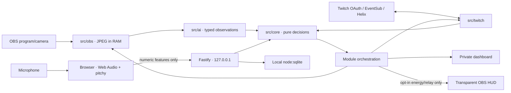

# Spotter

**Every Twitch tool watches the chat. Spotter watches the streamer.**

A local companion with three modules: Off the Map (identifying-clue exposure), Second Wind (personal voice energy) and Tag Out (click-approved crew raids). The model interprets; tested code decides.

## Current status

The private repository contains the scaffold, pure core, key-free scripted demo and implementations for Twitch, OBS/vision, local audio and crew relays. **Real-service verification and the submission are still pending.** No real raid, deletion, OBS action, model request or microphone capture was performed during development.

| Area | Verified | Still needed |
| --- | --- | --- |
| Scaffold/core/demo | Automated tests and browser walkthrough | Real demo media |
| Twitch | Mocked OAuth/Helix/EventSub tests | Credentials, CLI fixtures, live-channel recording |
| Off the Map | Vision contract, fail-soft and OBS adapter tests | Real OBS/model/privacy/moderation take |
| Second Wind | Synthetic tone, numeric WebSocket, profiles/reports | Real mic calibration and live-stream proof |
| Tag Out | Approval, live guards, cancellation, restart/rate-limit tests | Two-channel raid/tag-back recording |

## Run locally

Requires Node.js **22.18+**, npm, TypeScript strict/ESM. Checks here ran on Node **25.4.0**; the minimum Node version has not been exercised.

```sh
npm ci
cp .env.example .env
npm run dev
```

| Surface | Default URL |
| --- | --- |
| Private dashboard | http://127.0.0.1:5173/dashboard/ |
| Local microphone sensor | http://127.0.0.1:5173/sensor/ |
| Transparent OBS browser source | http://127.0.0.1:5173/overlay/ |
| Session report | http://127.0.0.1:5173/dashboard/report.html |
| Local API | http://127.0.0.1:3210/api/health |

Both servers bind to `127.0.0.1`. Keep this tool local. Vite updates frontend files automatically; restart the command after server edits. The API rejects foreign Host headers and write/WebSocket origins. It is not a hosted multi-user service.

## Key-free demo

```sh
npm run demo
```

No `.env` or credentials are needed. `SIM=1` disables all live integrations and microphone activation. The accelerated story shows generic clues accumulating, a reversible privacy blur, declining energy and chat activity, an audited simulated deletion, a partner suggestion and a relay. Click **Approve simulated raid**, then **Request tag back** and the partner's separate approval. **Replay simulated session** restarts the story. Every simulated view/source displays `SIMULATED`.

The default image is our synthetic SVG fixture. Mock clues follow the deterministic script; no model interprets those pixels. The initial chat window is warmed up so the report correctly compares 20 → 12 messages/min (−40%). Set `SIM_FRAME_DIR` to owned JPEG/PNG/SVG fixtures to replace the illustration: 1–20 images, at most 2 MB each and 20 MB total. Existing fixtures are read into memory; captured/model frames are never written to disk. Real IRL and voice media are pending.

## Twitch

Register an app with the exact redirect URI `http://localhost:3210/api/twitch/callback`. Set `TWITCH_CLIENT_ID`, `TWITCH_CLIENT_SECRET` and `TWITCH_REDIRECT_URI` in `.env`, start `npm run dev` and click **Connect with Twitch**. OAuth uses expiring, single-use state. Tokens remain in the ignored local SQLite database, are validated at startup/hourly and refreshed server-side. Server-created data uses owner-only permissions; protect `.env` too.

Native WebSocket EventSub handles chat, both raid directions and online/offline events. It subscribes immediately after welcome, dedupes IDs, watches keepalives and reconnects with backoff. The dashboard retains activity IDs and aggregates rather than raw chat text. Helix uses plain `fetch` without a Twitch SDK. Writes are not blindly retried after ambiguous failures.

Offline fixtures are synthetic shapes based on official docs, **not CLI captures**. Twitch CLI is not installed here. Complete its fixture/live steps in [the human verification checklist](docs/LIVE_CHECKLIST.md).

## Off the Map

Set `OPENAI_API_KEY` and `OPENAI_MODEL` to a model supporting image input and strict Structured Outputs. No model name is hard-coded. Set `OBS_WEBSOCKET_PASSWORD`, `OBS_WEBSOCKET_URL` and `OBS_PRIVACY_SCENE`. Optionally set both `OBS_SOURCE` and `OBS_BLUR_FILTER` to use a filter. With these configured, the live server samples 768px JPEGs every four seconds.

The schema contains clue categories, generic allowlisted descriptions, severity and confidence. Runtime parsing rejects extra fields, literal text, invalid values, refusals and incomplete responses. Core scoring combines distinct categories over time with decay. Configure `EXPOSURE_WARN`/`EXPOSURE_ACT` (defaults 60/80). A warning stays private; an action applies privacy and requests a marker. Missing analysis retains the score and cannot trigger an action. Dismiss restores the previous scene/filter state; restoration failure remains retryable.

The Responses request sets `store: false`. Images exist only in memory; the overlay receives no exposure/clue data. Provider-side handling follows your API account's data controls: this setting is not a claim of zero provider retention.

Chat Guard runs when Twitch and AI are configured. Pure core logic decides high-confidence guessing-message deletion. The private mod audit records message IDs, timestamps and outcomes before deletion; it never retains message text. Sensitive terms entered in the dashboard go to Twitch blocked terms without local storage. Keep their returned IDs for removal.

## Second Wind

Open the sensor and click **Enable local microphone**. Web Audio requests echo cancellation, noise suppression and automatic gain control off. `pitchy` clarity-gates F0. RMS, pitch median/range, spectral slope, voiced ratio, pause length and a rough envelope-peak speech-rate proxy are calculated in-browser. Only a closed object of numeric features leaves at approximately one-second intervals. Binary packets, extra fields, stale values and excessive rates are rejected.

Stop, page close or server disconnection releases microphone tracks. Keep the sensor page active: browsers may throttle background tabs; too few analysis frames produce no measurement. Sensor data older than five seconds is unavailable. Nothing records or uploads raw audio.

Calibration needs a ten-minute span and at least 300 usable windows. A numeric-only baseline profile is saved locally and can be recalibrated. Energy uses smoothed z-scores against that profile. Rally is separate: chat fills its meter and triggers a celebration/nudge without changing the measurement. **Public stamina/rally requires explicit HUD opt-in**; the opt-in resets on server restart.

The report shows this server session's curves, peak/low, percentage changes and correlation. Live numeric aggregates are saved every 30 seconds. It currently covers the running session; correlation establishes no cause, and energy is a heuristic, not a health/fatigue assessment.

## Tag Out

Run one local Spotter instance per broadcaster with separate API/Vite ports and SQLite files. Each authorizes its own Twitch account. Twitch tokens stay in that instance's database.

Copy [the crew example](docs/crew.example.json) to ignored `data/crew.json`, fill the partner's numeric Twitch user ID, local endpoint and shared secret, then set `CREW_FILE=data/crew.json`. Each instance's `CREW_SHARED_SECRET` goes into the other instance's peer config. The authenticated loopback status endpoint shares **only energy/live status**, never OAuth tokens or clues. Configure the second instance's ports, database and registered OAuth redirect as well.

Two minutes of low available energy can suggest a live high-energy partner. A click rechecks both streams via Helix, partner energy, source token ownership and the persisted request window. The UI waits for EventSub confirmation; the 90-second countdown is informational. Ambiguous write failure stays pending with a cancel path, without automatic retry or false success. State/attempts survive restarts and are isolated per broadcaster.

The receiving partner can request tag back and must approve it with their own dashboard/token. Their opt-in overlay shows “Covering for …’s community”. Both live channels, target settings and the actual raid must still be verified and recorded.

## Architecture and ethics



- Never output a location. Generic clue descriptions cannot contain transcribed text or coordinates.
- Keep scores/clues private; never send exposure to the public HUD.
- Raw audio stays local. Captured/model images are not saved.
- A low score says **“no obvious clues detected”**, never “safe”.
- Raids require a broadcaster click; privacy is dismissible; moderation is audited privately.
- Missing analysis means unavailable, never permission to act. Simulations are visibly labelled.

Scores and thresholds are initial deterministic heuristics, not validated safety guarantees. This local hackathon implementation is not a hosted security product. Real-service compatibility and the complete recorded product flow remain unproven until the checklist is completed.

## Checks and Codex

**45 automated tests** currently cover core decisions, contracts, service adapters, the scripted story, numeric WebSocket transport, persistence and process-level startup/shutdown. Browser QA covered the demo, report, mic refusal in SIM and transparent overlays at 1280×720 and 1920×1080.

```sh
npm test
npm run typecheck
npm run lint
npm run build
```

Tests use `node:test`/`node:assert` and fixtures under `test/fixtures/`. Startup checks open loopback ports; a sandbox that forbids `listen()` needs network-enabled execution. Lint checks whitespace, eval and core purity; TypeScript also checks unused declarations.

Codex read [BRIEF.md](BRIEF.md), followed [AGENTS.md](AGENTS.md), wrote core tests before changing logic, turned observed failures into regressions, and committed/pushed each implementation phase. See the dated [work log](docs/codex-log.md), [session ID](docs/CODEX_SESSION.md), [plan](PLAN.md) and [remaining human checklist](docs/LIVE_CHECKLIST.md).

References: [Twitch OAuth](https://dev.twitch.tv/docs/authentication/getting-tokens-oauth/), [EventSub](https://dev.twitch.tv/docs/eventsub/handling-websocket-events/), [Helix](https://dev.twitch.tv/docs/api/reference/), [Responses Structured Outputs](https://developers.openai.com/api/docs/guides/structured-outputs?api-mode=responses), [image input](https://developers.openai.com/api/docs/guides/images-vision), [OBS client](https://github.com/obs-websocket-community-projects/obs-websocket-js), [pitchy](https://github.com/ianprime0509/pitchy).
